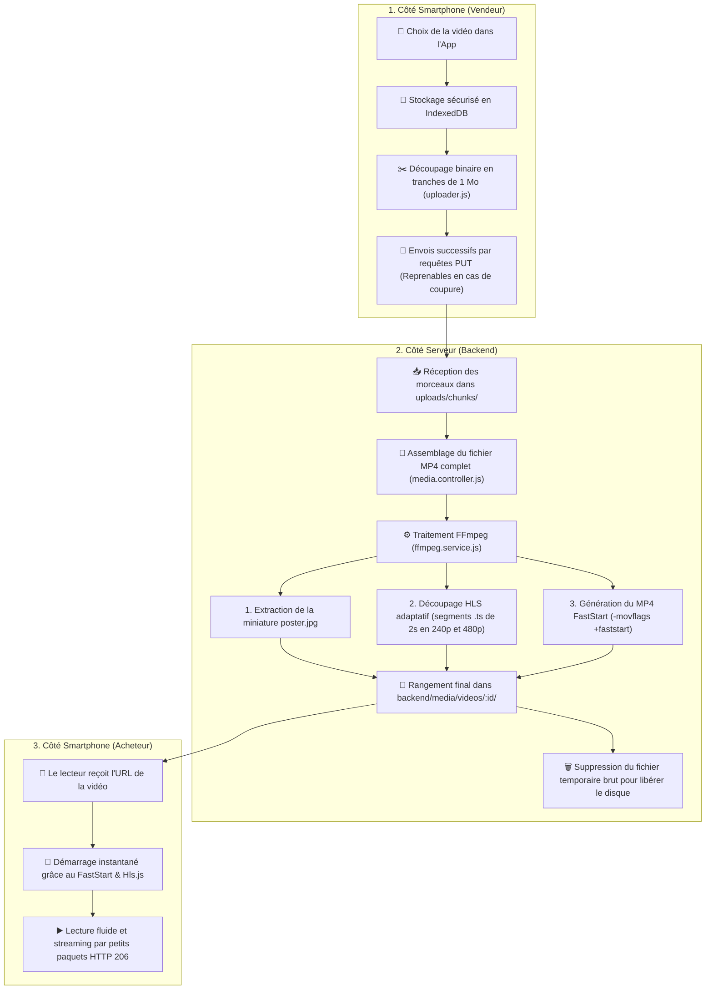

# 🎬 Guide de Présentation : Le Cycle de Vie Complet de la Vidéo dans ViteVendre

Ce document explique pas à pas, de façon claire et technique, comment fonctionne le traitement vidéo dans l'application : de la sélection sur le smartphone du vendeur jusqu'à la lecture fluide sur le téléphone de l'acheteur.

---

## 🗺️ Vue d'ensemble du pipeline vidéo



---

## 📌 ÉTAPE 1 : La sélection et l'envoi résilient (Smartphone Vendeur)

> **Problème à résoudre :** Au Cameroun, les réseaux mobiles (3G/4G) subissent des micro-coupures fréquentes. Envoyer une vidéo de 50 Mo d'un seul coup échoue 9 fois sur 10.

### 1. Lecture immédiate et isolation mémoire (`uploader.js`)
* Dès que le vendeur sélectionne sa vidéo, le fichier est lu **une seule fois** via `FileReader.readAsArrayBuffer()` et stocké dans **IndexedDB** (la base de données locale du navigateur).
* **Pourquoi ?** Sur Android WebView, appeler répétitivement le système de fichiers natif bloque l'application pour des raisons de sécurité (*"unsafe for access"*). Le passage par IndexedDB contourne ce blocage.

### 2. Découpage en morceaux de 1 Mo (Chunking Réseau)
* Le fichier est découpé en tranches régulières de **1 048 576 octets (1 Mo)** grâce à `Uint8Array.subarray()`.
* Chaque morceau a un numéro d'index débutant à 0 : `morceau 0`, `morceau 1`, `morceau 2`, etc.

### 3. Protocole d'upload avec reprise après coupure
1. **Initialisation** : L'app appelle `POST /api/media/uploads` avec la taille totale de la vidéo. Le serveur crée une session d'envoi et retourne un identifiant unique `uploadId`.
2. **Transfert** : Chaque tranche est envoyée individuellement via :
   ```http
   PUT /api/media/uploads/:uploadId/chunks/:index
   Content-Type: application/octet-stream
   ```
3. **En cas de coupure de réseau** :
   * L'application s'arrête sans planter.
   * Dès que la connexion revient, l'app demande au serveur : *"Quels morceaux as-tu déjà reçus ?"* (`GET /api/media/uploads/:uploadId`).
   * Le serveur répond par exemple `[0, 1, 2]`. L'application renvoie alors directement à partir du morceau `3`, **sans jamais recommencer à zéro**.
4. **Finalisation** : Quand tous les morceaux sont arrivés, l'app envoie `POST /api/media/uploads/:uploadId/complete`.

---

## 📌 ÉTAPE 2 : Réception, Réassemblage et Transcodage FFmpeg (Serveur)

### 1. Réassemblage du fichier original
* Le contrôleur backend ([`media.controller.js`](file:///c:/Users/Further%20Market/Desktop/new_app/backend/src/controllers/media.controller.js)) prend tous les fichiers temporaires `.part` dans `uploads/chunks/<uploadId>/` et les concatène dans l'ordre pour reformer le fichier MP4 complet.
* Il vérifie la taille finale et l'empreinte de sécurité pour s'assurer qu'aucun octet n'a été corrompu.

### 2. Le moteur FFmpeg ([`ffmpeg.service.js`](file:///c:/Users/Further%20Market/Desktop/new_app/backend/src/services/ffmpeg.service.js))
Dès que le MP4 est assemblé, le serveur déclenche FFmpeg pour réaliser 3 opérations en parallèle :

#### A. Extraction de l'affiche (`poster.jpg`)
* Extrait la première image de la vidéo à la seconde 0 (`-ss 0 -frames 1`).
* Cette image légère est affichée dans le feed avant même que l'utilisateur n'appuie sur Play.

#### B. Encodage HLS Adaptatif (Streaming haute performance)
* FFmpeg compresse et découpe la vidéo en **deux qualités** :
  - **240p** (Basse qualité / 350 kbps) : pour les connexions lentes / réseaux Edge ou 3G faible.
  - **480p** (Bonne qualité / 900 kbps) : pour le Wi-Fi ou la bonne 4G.
* Grâce à l'argument `-hls_time 2`, la vidéo est découpée en **petits fichiers `.ts` de 2 secondes chacun**.
* Un fichier chef d'orchestre `master.m3u8` est créé pour lister les flux disponibles.

#### C. Encodage MP4 optimisé FastStart (`-movflags +faststart`)
* Dans un fichier MP4 standard, la table des matières (l'atome **moov**) est écrite tout à la fin du fichier. Un smartphone doit donc télécharger toute la vidéo avant de pouvoir l'afficher.
* Grâce à **`-movflags +faststart`**, FFmpeg déplace ce bloc d'indexation au **tout début du fichier** : le lecteur vidéo mobile peut démarrer la lecture instantanément dès les premiers octets reçus.

### 3. Nettoyage du disque
* Une fois les segments créés dans `media/videos/<id>/`, le fichier lourd d'origine dans `uploads/` est **automatiquement supprimé** pour ne pas saturer l'espace disque du serveur.

---

## 📌 ÉTAPE 3 : La Lecture Instantanée (Smartphone Acheteur)

> **Problème à résoudre :** Éviter l'effet de "chargement infini" quand l'utilisateur fait défiler le fil d'annonces.

### 1. Affichage ultra-léger dans le feed
* Dans la liste, la vidéo n'est pas chargée immédiatement (`preload="none"`).
* L'application affiche uniquement la miniature `poster.jpg` : cela économise le forfait Internet de l'utilisateur.

### 2. Démarrage instantané au clic
Lorsque l'utilisateur touche la vidéo :
1. **Priorité Hls.js sur Android** :
   * Sur Google Chrome Android, le décodage natif du HLS est incomplet. L'application charge donc la bibliothèque JavaScript **Hls.js** qui télécharge les segments de 2 secondes les uns après les autres.
   * L'utilisateur n'attend que le chargement du premier segment de 2 secondes (moins de 100 Ko !) pour que la vidéo commence à jouer.
2. **Support des requêtes partielles (HTTP 206 Range Requests)** :
   * Le backend répond avec l'en-tête `Accept-Ranges: bytes`.
   * Si l'acheteur avance la vidéo de 10 secondes (seeking), le smartphone ne télécharge pas les 10 secondes précédentes : il demande directement l'octet correspondant au serveur.
3. **Sécurité et Fallback automatique** :
   * Si un appareil ancien ne gère pas le flux HLS, l'application bascule automatiquement et de manière transparente sur le fichier `video.mp4` FastStart.

---

## 📊 Résumé des fichiers clés à présenter

| Rôle | Fichier | Ce qu'il fait en une phrase |
|---|---|---|
| **Frontend - Upload** | [`noteApp/www/js/services/uploader.js`](file:///c:/Users/Further%20Market/Desktop/new_app/noteApp/www/js/services/uploader.js) | Découpe la vidéo en tranches de 1 Mo et gère la reprise après coupure réseau. |
| **Frontend - Lecture** | [`noteApp/www/js/app.js`](file:///c:/Users/Further%20Market/Desktop/new_app/noteApp/www/js/app.js) | Pilote le lecteur vidéo avec Hls.js, écoute l'événement `play` et gère le fallback MP4. |
| **Backend - Contrôleur** | [`backend/src/controllers/media.controller.js`](file:///c:/Users/Further%20Market/Desktop/new_app/backend/src/controllers/media.controller.js) | Réceptionne les morceaux de 1 Mo et réassemble le fichier final. |
| **Backend - Transcodage** | [`backend/src/services/ffmpeg.service.js`](file:///c:/Users/Further%20Market/Desktop/new_app/backend/src/services/ffmpeg.service.js) | Découpe en HLS (2s) et applique l'optimisation FastStart (`-movflags +faststart`). |
| **Backend - Serveur** | [`backend/src/app.js`](file:///c:/Users/Further%20Market/Desktop/new_app/backend/src/app.js) | Sert les vidéos avec les en-têtes HTTP de streaming partiel (`Accept-Ranges: bytes`). |
