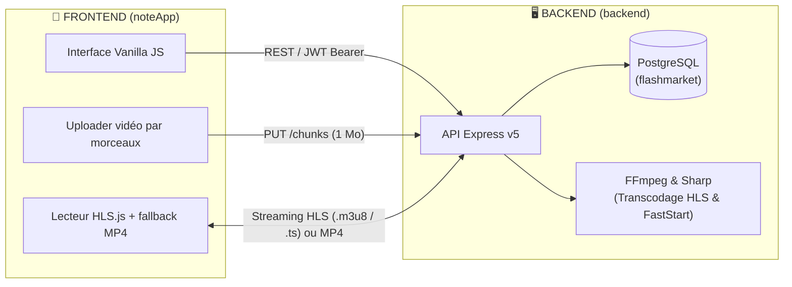

# 📱 ViteVendre / FlashMarket — Documentation Complète

Marketplace locale mobile conçue pour le contexte camerounais (réseau mobile instable, vidéo courte, contact direct via Appel / WhatsApp, sans paiement en ligne obligatoire).

---

## 🏛️ Architecture globale du projet

Le projet est divisé en deux grandes parties autonomes :



---

## 🖥️ 1. Côté BACKEND (`/backend`)

API REST développée avec **Node.js (CommonJS)**, **Express v5** et **PostgreSQL**.

### 📁 Structure des dossiers
```
backend/
├── database/
│   ├── schema.sql           # Schéma PostgreSQL complet (tables, contraintes, index)
│   └── seed.sql             # Données initiales (villes du Cameroun, catégories)
├── scripts/
│   └── db-init.js           # Initialisation ou reset de la base de données
├── src/
│   ├── config/
│   │   ├── db.js            # Pool de connexion PostgreSQL (pg)
│   │   └── env.js           # Validation et chargement des variables d'environnement (.env)
│   ├── controllers/
│   │   ├── auth.controller.js     # Inscription téléphone/mot de passe, connexion JWT
│   │   ├── catalog.controller.js  # Liste des villes et catégories actives
│   │   ├── media.controller.js    # Upload vidéo en morceaux (chunking) et consultation
│   │   ├── post.controller.js     # CRUD des annonces (feed, publication)
│   │   └── shop.controller.js     # Profil boutique vendeur (1 par compte)
│   ├── middlewares/
│   │   ├── authenticate.js        # Vérification du token JWT
│   │   ├── errorHandler.js        # Gestion globale des erreurs HTTP
│   │   └── upload.middleware.js   # Configuration de Multer pour les images
│   ├── services/
│   │   ├── ffmpeg.service.js      # Transcodage HLS (240p/480p) et MP4 FastStart
│   │   ├── hash.service.js        # Calcul des empreintes SHA-256 et pHash (perceptuel)
│   │   ├── image.service.js       # Compression des photos en WebP via Sharp
│   │   └── media-queue.service.js # File d'attente de traitement asynchrone des médias
│   ├── app.js               # Configuration Express (CORS, Helmet, route /media statique)
│   └── server.js            # Démarrage du serveur HTTP sur le port configuré
```

### ⚡ Fonctionnalités Backend clés
1. **Upload vidéo par morceaux reprenable (Chunking)** :
   * Route `POST /api/media/uploads` : initialise la session d'upload avec taille totale et taille de morceau (1 Mo).
   * Route `PUT /api/media/uploads/:id/chunks/:index` : reçoit chaque morceau binaire de 1 Mo. Si la connexion coupe, l'application peut reprendre sans renvoyer ce qui a déjà été envoyé.
   * Route `POST /api/media/uploads/:id/complete` : réassemble les morceaux, vérifie la signature du fichier et lance le traitement.
2. **Traitement vidéo FFmpeg & Optimisation FastStart** :
   * **Découpage HLS (`.m3u8` et `.ts`)** : découpe la vidéo en segments indépendants de 2 secondes en deux qualités adaptatives (240p et 480p).
   * **FastStart (`-movflags +faststart`)** : déplace les métadonnées (le *moov atom*) au tout début du fichier MP4 pour que la lecture démarre instantanément sur smartphone sans attendre le téléchargement complet.
   * **Streaming HTTP 206 (Range Requests)** : en-tête `Accept-Ranges: bytes` activé sur `/media` pour permettre l'avance rapide (seeking) dans la vidéo.
3. **Sécurité et performance** :
   * Mots de passe chiffrés avec `bcryptjs`.
   * Jetons JWT valables 7 jours.
   * Photos automatiquement converties au format moderne WebP (Sharp).

---

## 📱 2. Côté FRONTEND (`/noteApp`)

Application mobile hybride développée avec **Apache Cordova** et **JavaScript Vanilla (ES Modules)**, optimisée pour être ultra-légère et rapide sur Android.

### 📁 Structure des dossiers
```
noteApp/
├── config.xml               # Configuration Cordova (Permissions, whitelist réseau, scheme)
├── resources/
│   └── android/
│       ├── network_security_config.xml # Autorisation du trafic clair HTTP en local
│       └── ... (icônes de l'application ldpi à xxxhdpi)
├── www/
│   ├── index.html           # Page principale avec balise Content-Security-Policy (CSP)
│   ├── css/
│   │   ├── tokens.css       # Variables CSS (couleurs, espacements, typographies)
│   │   ├── base.css         # Reset et styles de base
│   │   └── style.css        # Styles de l'application et composants
│   ├── img/                 # Logos et icônes SVG de ViteVendre
│   ├── lib/
│   │   └── hls.min.js       # Bibliothèque Hls.js pour la lecture du streaming vidéo
│   └── js/
│       ├── config.js        # Détection dynamique de l'IP du serveur (Starlink/Wi-Fi/Émulateur)
│       ├── app.js           # Contrôleur principal (UI, feed, lecture vidéo, navigation)
│       ├── main.js          # Point d'entrée du chargement
│       ├── router.js        # Routeur côté client (pages feed, favoris, compte, boutique)
│       ├── store.js         # Gestion d'état réactive simple
│       ├── api/
│       │   └── client.js    # Client HTTP Fetch avec gestion des timeouts et retries
│       ├── services/
│       │   ├── uploader.js  # Découpage vidéo (Blob.slice) et upload reprenable
│       │   ├── network.js   # Surveillance de la qualité réseau (online/offline/2G/4G/wifi)
│       │   ├── storage.js   # Wrapper LocalStorage sécurisé
│       │   ├── cache.js     # Mise en cache locale des villes et annonces
│       │   └── format.js    # Formatage des prix en FCFA et des dates
│       └── ui/
│           └── icons.js     # Bibliothèque d'icônes SVG inline
```

### ⚡ Fonctionnalités Frontend clés
1. **Routage réseau dynamique ([`config.js`](file:///c:/Users/Further%20Market/Desktop/new_app/noteApp/www/js/config.js))** :
   * Détecte si l'app tourne dans un navigateur mobile ou dans l'APK compilé.
   * Se connecte automatiquement à l'adresse IP locale du PC sur le même Wi-Fi Starlink (`192.168.1.208:3000`).
2. **Double moteur de lecture vidéo ([`app.js`](file:///c:/Users/Further%20Market/Desktop/new_app/noteApp/www/js/app.js))** :
   * Priorité à **Hls.js** sur Android pour décoder le flux adaptatif.
   * Fallback automatique vers le fichier **`video.mp4` FastStart** en cas de coupure ou d'incompatibilité.
   * Déclenchement sur l'événement mobile natif `play` et `click`.
3. **Uploader robuste en mémoire ([`uploader.js`](file:///c:/Users/Further%20Market/Desktop/new_app/noteApp/www/js/services/uploader.js))** :
   * Stocke temporairement la vidéo sélectionnée dans IndexedDB.
   * Découpe le flux binaire en tranches exactes de 1 Mo (`1048576 octets`) avec délai inter-chunk pour éviter de saturer la pile réseau mobile.
4. **Déverrouillage réseau Android ([`config.xml`](file:///c:/Users/Further%20Market/Desktop/new_app/noteApp/config.xml))** :
   * Scheme configuré en `http` pour éviter le blocage *Mixed Content*.
   * `network_security_config.xml` configuré pour autoriser le trafic HTTP local.

---

## 🚀 Guide de démarrage et tests locaux

### Prérequis
* Node.js v18+ installé sur le PC.
* PostgreSQL en cours d'exécution.
* FFmpeg installé et référencé dans `backend/.env`.
* PC et téléphone Android connectés au **même réseau Wi-Fi** (ex: Starlink).

---

### Étape 1 : Démarrer le Backend
```powershell
cd "c:\Users\Further Market\Desktop\new_app\backend"
npm install
npm run db:init      # Initialise les tables et les villes de test
npm run dev          # Lance le serveur sur http://localhost:3000 (ou 192.168.1.208:3000)
```
> **Vérification :** Depuis le navigateur de ton téléphone, ouvre :  
> 👉 `http://192.168.1.208:3000/api/health` → doit répondre `{"status":"ok","db":"ok"}`.

---

### Étape 2 : Tester l'application

#### Option A — Via le navigateur Chrome sur ton téléphone :
Sur ton PC :
```powershell
cd "c:\Users\Further Market\Desktop\new_app\noteApp"
npm run web
```
Puis sur ton téléphone dans Google Chrome, ouvre :  
👉 **`http://192.168.1.208:8000/index.html`**

#### Option B — Installer et lancer l'APK Android (via USB) :
1. Active le **Débogage USB** sur ton smartphone Android.
2. Branche ton téléphone en USB au PC.
3. Exécute :
```powershell
cd "c:\Users\Further Market\Desktop\new_app\noteApp"
cordova run android
```
L'APK se compile, s'installe et s'ouvre automatiquement sur le téléphone connecté au backend !
